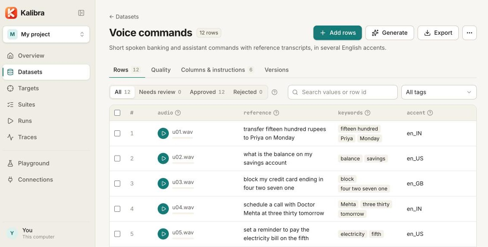
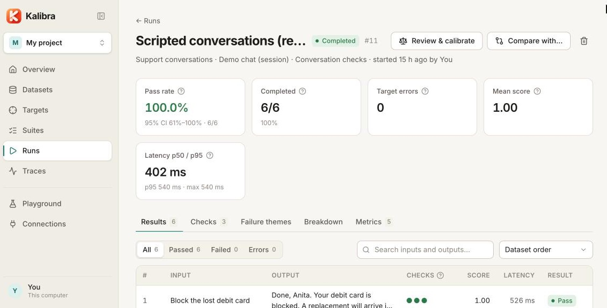
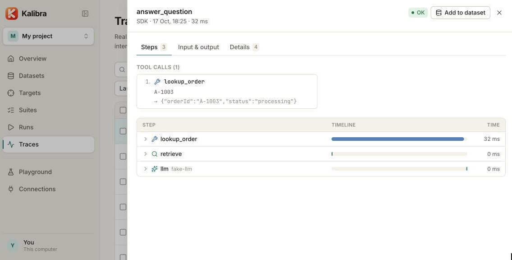

<div align="center">


# Kalibra

**Local-first, open-source evaluation for AI applications.**

Build test data, point Kalibra at your real app, score every answer with checks you can trust, and see what got better or worse.

[](https://www.npmjs.com/package/kalibra)
[](LICENSE)
[](https://nodejs.org)

[Quick start](#quick-start) · [What it does](#what-it-does) · [Connect your app](#connect-your-app) · [Teams](#teams) · [Docs](docs/README.md)


</div>

## Quick start

```bash
npx kalibra@next
```

That starts Kalibra on your machine and opens it in the browser. No account, nothing to host. Your data stays in `~/Kalibra/default`.

| Prefer… | Use |
|---|---|
| A command you keep | `npm i -g kalibra@next`, then `kalibra` (same data folder as npx) |
| A team server | `docker run -p 4317:4317 -v kalibra-data:/data ghcr.io/libreguild/kalibra:next`, then open `http://localhost:4317/kalibra/` ([self-hosting guide](docs/self-hosting.md)) |

## What it does

1. **Datasets:** test cases with text, audio and image columns. Import CSV/JSONL, upload recordings, generate rows, images or speech with any model, add safety and jailbreak tests, or turn real traffic from your app into test rows.
2. **Targets:** how Kalibra calls your app: an HTTP API (JSON, multipart, streaming), a WebSocket audio stream, a model with a prompt, or your own script. Multi-turn conversations, scripted or with a simulated user.
3. **Checks, layered cheapest first:** status and latency → JSON schema and fields → contains/regex → WER/CER, BLEU/ROUGE, meaning similarity (free and offline) → LLM judges you can calibrate against your own labels. Plus refusal and PII checks, and agent and RAG checks (right tool, right arguments, answers grounded in the retrieved documents).
4. **Runs:** pass rates with confidence intervals, corpus WER, streaming latency, tokens, failure themes ("what broke and why"), and side-by-side comparisons of models and versions with significance tests.
5. **Improve:** try prompts across models in the playground, review and label results, and track trends across releases.

Every structured option has a script escape hatch, so you are never blocked by what the UI anticipated.

<table>
  <tr>
    <td></td>
    <td></td>
  </tr>
  <tr>
    <td align="center"><sub>Datasets with audio, text and image columns</sub></td>
    <td align="center"><sub>Runs with confidence intervals and per-row checks</sub></td>
  </tr>
</table>

## Connect your app

Kalibra calls your app from outside like any client. When you want to see *inside* (retrieved documents, tool calls, prompts), add the SDK. It's dev-only by default and costs nothing when it's off.

```ts
import { kalibra } from 'kalibra-sdk';
kalibra.init({ enabled: process.env.NODE_ENV !== 'production', key: process.env.KALIBRA_KEY, project: 'Support bot' });

export const answer = kalibra.trace('answer', async (question: string) => {
  const docs = await kalibra.step('retrieve', () => search(question), { kind: 'retrieval' });
  return kalibra.step('llm', () => llm(question, docs), { kind: 'llm' });
});
```

```python
import kalibra
kalibra.init(enabled=os.getenv("ENV") != "production", key=os.getenv("KALIBRA_KEY"), project="Support bot")

@kalibra.trace("answer")
def answer(question): ...
```

- **Traces:** see every real request with its steps, and add the interesting ones to a dataset in one click. OpenTelemetry and an OpenAI-compatible proxy work without code changes.
- **Evals in your tests:** `evaluate()` runs a dataset through your own function inside `vitest`, `jest` or `pytest`; CI comments the pass rate and new failures on each pull request.
- **Tool record and replay:** record real tool responses once, then replay them so evals are fast, free and never send a real email or refund.



More: [packages/sdk](packages/sdk/README.md) · [sdks/python](sdks/python/README.md) · [design](docs/design/sdk-and-traces.md)

## Coding agents

Kalibra speaks MCP, so Claude Code, Codex, Cursor or Gemini CLI can fill datasets, set up targets and run evals for you, with the same operations as the UI. You drive your own agent; Kalibra never starts one.

```bash
claude mcp add kalibra -- npx -y kalibra@next mcp
```

## Teams

- **On your machine** (`npx kalibra` or `kalibra`): projects in a local folder, no sign-in.
- **Team server** (`kalibra server` or Docker):
  - sign-in with passwords, any OIDC/SSO (Google, Microsoft, Okta, company SSO), GitHub and GitHub Enterprise, or a login gateway;
  - viewer, editor and owner roles per project, and groups;
  - access tokens for agents and CI;
  - an audit log and backups.
- **No server at all:** `.kalibra` bundles, a Git-synced folder, and importers for promptfoo, OpenAI Evals, LangSmith and Langfuse.

See [users and projects](docs/users-and-projects.md) and [self-hosting](docs/self-hosting.md): one VM, a bucket, Postgres, or several instances with Redis.

## Docs

- **In the app:** profile menu → **Platform docs** (short, illustrated guides) and **SDK docs** (JavaScript/TypeScript and Python).
- **Developers:** [docs/](docs/README.md): [architecture](docs/architecture.md) · [engine](docs/engine.md) · [data model](docs/data-model.md) · [targets & checks](docs/targets-and-checks.md) · [MCP](docs/mcp-and-agents.md) · [testing](docs/testing.md) · [build & run](docs/build-and-run.md)
- **Product:** [features](docs/features.md) · [roadmap](docs/roadmap.md)

## Develop

```bash
npm install
npm run dev                 # engine :4317 + UI http://localhost:5173/kalibra/ + demo apps :4400
npm run demo -- --seed      # once: demo datasets, targets and suites in ./.kalibra-dev
npm run typecheck && npm test
```

```
packages/
  core/      engine: operations, hub (users, projects), datasets, targets, checks, runner, traces, providers
  server/    HTTP API, sign-in, live events, ingest, files
  web/       React UI
  cli/       kalibra serve | server | run | mcp | backup  (npm: kalibra)
  sdk/       JavaScript SDK (npm: kalibra-sdk)
  demo/      mock apps under test + demo data
sdks/python/ Python SDK (PyPI: kalibra-sdk)
action/      GitHub Action for evals on pull requests
deploy/      Docker Compose + Caddy
docs/        developer docs
```

Each package has a README with its code map. Contributions go through pull requests: see [CONTRIBUTING.md](CONTRIBUTING.md). Security reports: [SECURITY.md](SECURITY.md).

## License

[MIT](LICENSE) © Kalibra contributors
